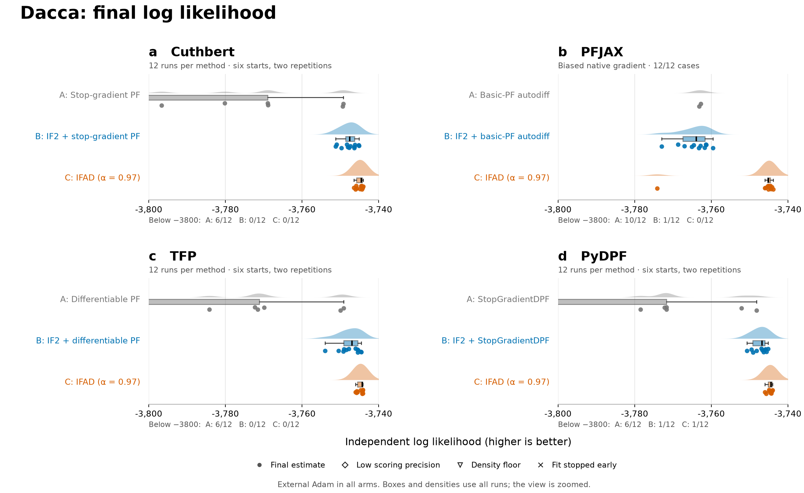

# Dacca comparisons

We compare particle filters and likelihood optimization for the Dacca cholera model, using the original package functions and our additions for IF2 and discounted gradients.



Independent log(mean likelihood), higher is better. Each method has twelve runs. The view is zoomed; all scores enter the boxes and densities. [Full range, paired differences and PDF versions](reports/figures.md).

| Read | Contents |
|---|---|
| [Results and figures](reports/optimization.md) | Twelve runs per method, independent likelihoods and fitting times |
| [PF runtime](reports/timing.md) | Ordinary-filter timings, with compilation separate |
| [Correctness](reports/correctness.md) | Agreements, failed checks and unresolved differences |
| [Design](reports/dacca_comparison.md) | Model, methods, starts and evaluation |
| [Code changes](docs/package_calls.md) | Original functions, additions and readable diffs |
| [Standalone package revisions](docs/upstream_review.md) | Installation, portable tests and remaining checks before upstream submission |

PFJAX A/B use automatic differentiation through the package's basic particle filter. Results from our earlier α=1 correction are reported separately. Each method uses the same six starting vectors, with two repetitions per vector. All failures, density-floor scores and scores with low precision are retained.

```bash
make figures    # NumPy and Matplotlib required
make overview   # Requires local archives; no PF or fitting
make check      # Requires local archives; verifies files, source recovery and tables
```

[Reproduction](docs/reproduction.md) · [Data](results/README.md) · [Active work](reports/status.md) · [Archive](archive/README.md) · [Source and license notices](THIRD_PARTY.md).

The main tree contains current reports, figures, result tables and package patches. Earlier reports and progress records are archived. Bulk archives are stored locally and excluded from Git; a clone does not include them. To rebuild summaries, recover complete source trees or run the full integrity check, also obtain the files listed in [the archive catalog](archive/catalog.json).
