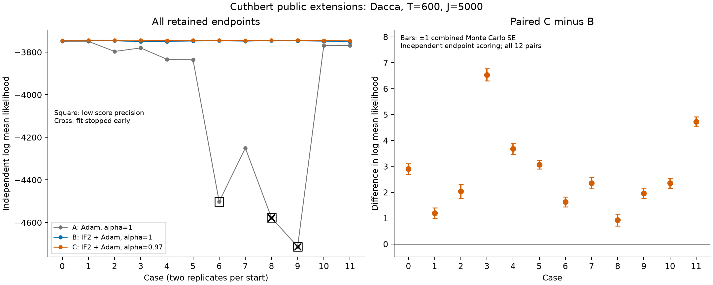
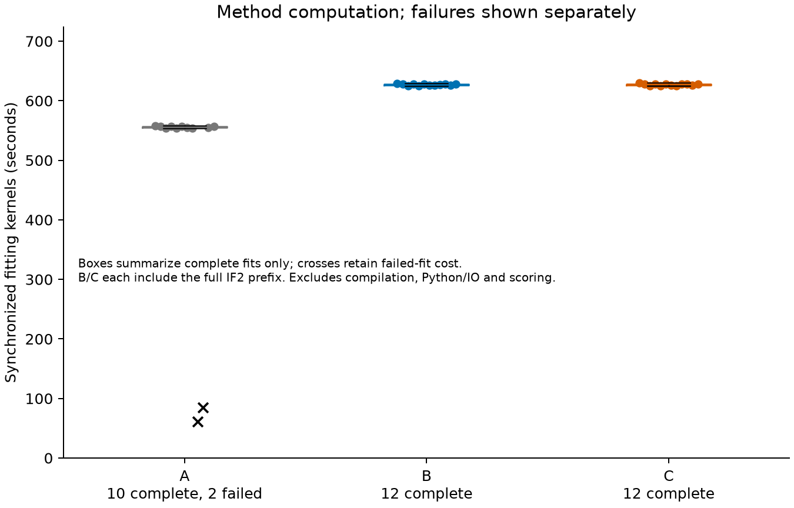

# Cuthbert: IF2 initialization and gradient discounting

All 12 planned cases are complete and audited. For the six recorded starts, each run twice, IF2 followed by Adam with alpha=0.97 (C) gives a higher independently estimated likelihood than IF2 followed by Adam with alpha=1 (B) in all 12 pairs. The paired increase has median 2.351684 log units and range 0.931123–6.533724. Both methods complete all 400 Adam updates in every case. This is an empirical result for these starts and this model; it does not establish universal optimizer superiority.

## Optimization results

| Method | Median log mean likelihood (12 retained endpoints) | Complete fits | Precise scores | Median fitting kernel seconds (complete fits) |
|---|---:|---:|---:|---:|
| A | -3814.966803 | 10/12 | 9/12 | 555.756 |
| B | -3747.557538 | 12/12 | 12/12 | 627.436 |
| C | -3744.501336 | 12/12 | 12/12 | 627.586 |

A is Adam400 from the original start with alpha=1. B is IF2 with 175 passes followed by Adam400 with alpha=1. C uses exactly the same saved IF2 endpoint as B, then Adam400 with alpha=0.97. B and C start with identical parameters, zero Adam state, learning rates and training random keys. The physical IF2 calculation is shared once per case. The execution order rotates ABC, BCA, CAB; scoring uses fixed A/B/C codes regardless of order.

The likelihood medians include all 12 endpoints per method, including the two failed A fits' last accepted parameters. A's median among its ten complete fits is −3788.390797. A failed at 43 and 60 accepted updates in cases 8 and 9. A's cases 6, 8 and 9 reached the maximum 288 scoring repetitions but did not meet the likelihood-ESS requirement. These are separate fit and scoring outcomes. The other 33 scores meet both precision requirements. No score is nonfinite or density-floor saturated.

The left panel retains the full range. Squares mark low-precision scores and crosses mark failed fits. In the right panel, bars show plus or minus one combined Monte Carlo standard error, calculated from independent B/C scoring errors. These bars describe scoring uncertainty, not variation across new starts. Cases 2s and 2s+1 share start s. They are not twelve independent starting points.

[Per-method display](likelihood_iqr.png) applies the requested 1.5×IQR rule to each method's 12 scores using linear-interpolated quartiles. It hides zero points for all three methods. Separate vertical scales show B and C clearly. All statistics use all retained endpoints.

## Time and resource use

The time column above measures synchronized fitting kernels. B and C each include the full IF2 prefix in their method cost; A has no IF2 prefix. Thus A and B do not have equal computational budgets. These timings exclude compilation, Python checks, file IO and independent scoring. A's two failed-fit times, 61.260 and 85.182 seconds, are retained separately and are not evidence of faster successful fitting.

The twelve one-A40 allocations used 23,034 GPU seconds (6.3983 GPU hours), including fitting, compilation, scoring and process overhead. Adding the 879-second v3 check and 321-second repeat diagnosis gives 24,234 seconds, within the 42,480-second formal allocation budget. The earlier validation jobs used a separate 2,677 seconds; total recorded Cuthbert checking and formal allocation use is 26,911 GPU seconds. Concurrent GPU seconds are summed as resource use, not presented as elapsed waiting time. Slurm ElapsedRaw is used across the daylight-saving clock change.

Shared IF2 and alpha=1 compilation are counted once physically. The alpha=1 compilation is recorded against the arm executed first, so the per-arm compile fields cannot rank methods. Complete per-case allocation and kernel times are in the [audit](../../results/cuthbert/final_audit_20261101.json).

## Model and independent scoring

The original Dacca model has 600 monthly observations, 20 Gaussian Euler steps per month and 5,000 particles. There are 23 updated coordinates: 18 process/observation coordinates and five normalized initial-state coordinates. The normalization introduces redundancy; these are not 23 independently identifiable parameters. This experiment should not be described as the email's 15-parameter specification without explaining this difference.

Every retained endpoint is evaluated by the fixed original PyPOMP PF with J=5000, using log(mean likelihood), not mean(log likelihood). Repetitions increase 36, 72, 144, 288 until MCSE<=1 and likelihood ESS>=10, or the limit is reached. All 2,052 raw PF values and stage records are retained. Training uses root 24681000 and scoring root 94681000, with typed scoring keys and fixed A0/B1/C2 codes. The total audit checks score roots, chunks and PF-repeat keys against the enumerated training roots, IF2-pass keys and gradient-iteration keys; it does not claim to enumerate every internal model draw.

## Code and correctness

The [18-file diff](../../packages/cuthbert/review/full.patch) is against Cuthbert c737efe3098b2b5ecaa7d8b976e7cea246998b17. The extensions call the original `particle_filter.build_filter`, `filter_prepare` and `filter_combine`. An added `scan_final` loop iterates over observation times; the driver does not call the top-level `cuthbert.filter`. At alpha=1, DMOP calls the unchanged original `stop_gradient_decorator`. Discounted derivatives and general parameter perturbation are added code. None of these additions has been accepted upstream.

The formal driver calls the added public `iterated_filtering.fit` and `dmop.log_likelihood`, with external Optax `scale_by_adam`. It does not call the combined `ifad.fit`. All arms set checkpoint=False. The package source, model callbacks, starts, fitting driver and scorer stayed frozen throughout the twelve cases.

Forward likelihoods matched the original in all 24 v3 paired checks, with finite gradients, and the 32 new public GPU tests passed. The v3 job nevertheless remains FAILED: some gradient comparisons failed the old rule, the PF regression timed out after 61 visible passes of 64, and the earlier-failure recheck timed out. The earlier three failing upstream tests also failed in an unchanged-original control. The local full CPU coverage has 1,548 passes across the retained dependency-repair runs, not a single clean initial run.

A later GPU repeat diagnosis found that seven of nine original-versus-original J5000 pairs also failed the old per-coordinate gradient rule. Corresponding forward likelihoods were identical. This showed that the rule could reject the original implementation itself; it did not locate the responsible GPU operation or certify mathematical derivatives. The user accepted forward-likelihood agreement for proceeding with this empirical comparison. All old failures remain preserved. See [correctness](../correctness.md), [repeat diagnosis](../cuthbert_repeats_20261101.md) and [reference-test review](../reference_tests_20261101.md).

Cases 8 and 9 stopped at the recorded nonfinite guard. Rejected proposal values were not saved, so the records cannot identify whether the loss, gradient, transformed parameter or optimizer state triggered it. The last accepted parameters and Adam state are retained. No failed fit or low-precision score was rerun.

## Ordinary PF runtime

The earlier independent A40 timing measured a median of 0.393526222 seconds for a single original Cuthbert PF call at T=600/J=5000 (seven timed calls, batch size 1), with compilation separately recorded as 3.120166274 seconds. That experiment was not repeated. It is not the optimization time above and does not establish an ordinary-PF speed improvement from these extensions. See [PF runtime](../timing.md).

## Every endpoint

| Case | Start / replicate | A | B | C | A status |
|---:|---|---:|---:|---:|---|
| 0 | 0 / 0 | -3749.346585 | -3747.740628 | -3744.844912 | Complete; precise |
| 1 | 0 / 1 | -3749.191836 | -3745.203526 | -3744.010797 | Complete; precise |
| 2 | 1 / 0 | -3796.621696 | -3746.262568 | -3744.227977 | Complete; precise |
| 3 | 1 / 1 | -3780.159897 | -3750.942197 | -3744.408473 | Complete; precise |
| 4 | 2 / 0 | -3833.311910 | -3749.740281 | -3746.065480 | Complete; precise |
| 5 | 2 / 1 | -3835.318563 | -3747.374447 | -3744.307549 | Complete; precise |
| 6 | 3 / 0 | -4502.184005 | -3746.218160 | -3744.594199 | Complete; low precision |
| 7 | 3 / 1 | -4250.237730 | -3748.064527 | -3745.709941 | Complete; precise |
| 8 | 4 / 0 | -4577.584559 | -3745.106671 | -3744.175548 | Failed; low precision |
| 9 | 4 / 1 | -4713.211742 | -3746.358664 | -3744.393958 | Failed; low precision |
| 10 | 5 / 0 | -3768.950269 | -3748.262771 | -3745.913990 | Complete; precise |
| 11 | 5 / 1 | -3768.872479 | -3751.215054 | -3746.495341 | Complete; precise |

[36-row table](../../results/cuthbert/endpoints.csv) · [descriptive statistics](summary.json) · [full audit](../../results/cuthbert/final_audit_20261101.json) · [Chinese supplementary report](report_CN.md)

## Reproduce and review

The standalone [review archive](../../artifacts/experiments/dacca/cuthbert_review_20261101.tar.gz) contains original and modified sources, the full diff, model inputs, frozen fitting/scoring programs, complete IF2/Adam/RNG states, all raw scores and failures, Slurm records, validation history, reports and figure programs. Its README describes saved-data audit and plot commands. The [archive catalog](../../archive/catalog.json) records its SHA256. Restoring and auditing saved results does not rerun a PF or fit. Numerical reruns require the recorded GPU software and explicit path adjustments in a separate copy; frozen launchers are historical records, not portable one-command installers.

The original all-case review attempt encountered a rounding difference between the old case0 and general score-summary formulas (MCSE difference 2.78e-17; ESS difference 7.11e-15). Its script and failure are retained. The revised audit uses the existing 1e-12 score-statistic rule for those two legacy fields, while independently recalculating every raw score. Fitting, scoring, original outputs and their thresholds were unchanged.
