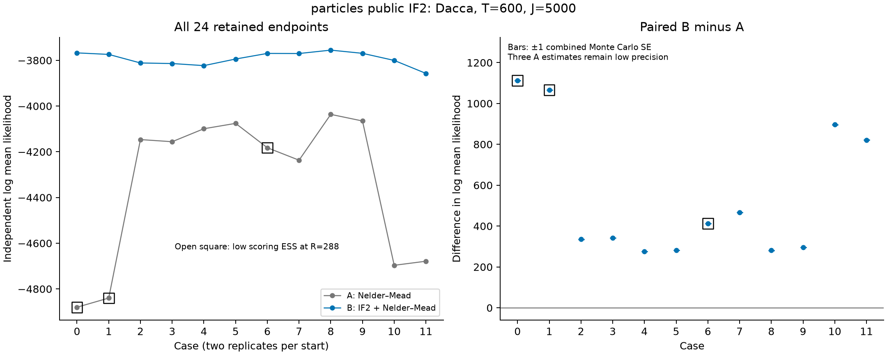
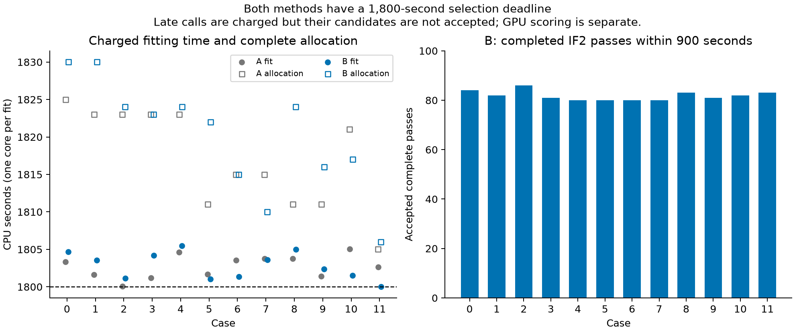
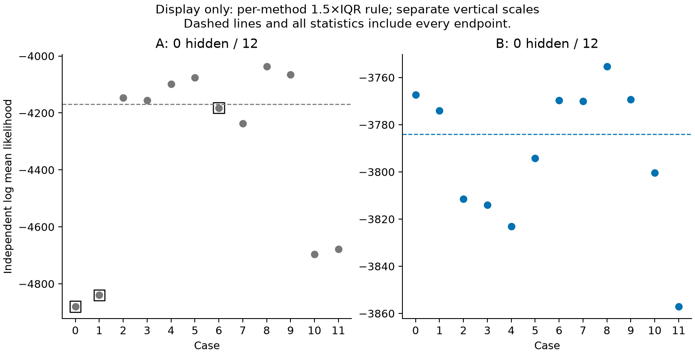

# particles: Dacca optimization with public IF2

The 24 planned fits are complete. Adding public IF2 before external SciPy Nelder–Mead gave a higher independently scored endpoint in all 12 paired cases. This is an observation from six starts and two replicates, with three A scores still below the required likelihood ESS. It does not establish a general optimizer ranking.

| Method | Fits | Median log mean likelihood, all endpoints | Scores meeting precision requirement | Median charged fit seconds |
|---|---:|---:|---:|---:|
| A: native PF + Nelder–Mead | 12 | −4169.071 | 9/12 | 1803.002 |
| B: public IF2 + Nelder–Mead | 12 | −3784.099 | 12/12 | 1802.968 |

The paired B minus A difference has median 377.263 across all 12 cases. Among the nine pairs for which both scores meet the precision requirement, all nine differences are positive and their median is 335.129. These are different subsets, not corrected versions of the same statistic. No fit failed and no score hit the density floor. A tasks 0, 2 and 12 remain low precision after 288 independent PF evaluations; they are retained in every full-data summary.

## Code and experiment

The base package commit is `3388c4bd30ab9acc5a27c970089230f93610b627`. Our five-file extension adds generic parameter perturbation and public IF2, with tests, documentation and an example. Both methods use the package's complete `particles.core.SMC.run` filtering loop. The extension does not replace that loop with a Dacca-specific PF. Nelder–Mead is provided by SciPy, outside the package. See the [readable diff](../../packages/particles/review/full.patch).

Both methods use the original 600-month Dacca data, 20 Gaussian Euler steps per month and 5,000 particles. They update 23 coordinates: 18 process/observation coordinates and five normalized initial-state coordinates. The latter representation is redundant; these are not 23 independently identifiable parameters. Fitting uses CPU float64.

Each fit has a 1,800-second candidate-selection deadline. A spends this time on Nelder–Mead. B first runs public IF2 for up to 900 seconds, then uses Nelder–Mead until the same total deadline. B accepts 80–86 complete IF2 passes. The perturbation scales are 0.02 for ordinary process coordinates and 0.16 for initial-state coordinates at the first observation, with cooling 0.5 at pass 50. IF2 uses multinomial resampling; the subsequent native-PF objective uses systematic resampling with ESS threshold 1.

Under the frozen Nelder–Mead protocol, the endpoint is the best training objective among evaluations completed before the deadline. Late evaluations remain recorded and charged, but cannot change the endpoint. This differs from the final-valid-iterate rule used in the GPU Adam comparisons. Independent scoring never selected the endpoint. The full parameter swarm and NumPy RNG state are saved for each IF2 pass.

## Independent scoring and cost

All endpoints use the fixed original PyPOMP PF with J=5,000. The estimate is log(mean likelihood), with cumulative sample sizes 36, 72, 144 and 288. Scoring stops when MCSE ≤ 1 and likelihood ESS ≥ 10, or at 288. All 1,692 raw values were independently summarized again from saved records. The scoring source SHA is `8aec1ba02982a1ad9bff227b300806eaafa972a1e9fd00b71bef2c5f0ebdc508`.

Training uses the recorded NumPy seed blocks rooted at 24981000; scoring uses independent typed JAX keys rooted at 94981000, with fixed A/B arm codes. The audit verifies the recorded training blocks and scoring keys. It does not enumerate every internal random draw or equate keys from different PRNG families.

The 24 one-core fitting allocations used 43,647 CPU seconds in total. CPU validation used a further 155 seconds, including the original failed attempt. Independent A40 scoring used 96 GPU seconds. The nominal selection budget is 43,200 CPU seconds; completed late calls and process overhead explain the additional allocation time. The 24 requested 45-minute limits total 18 CPU hours. GPU scoring is a separate expense, not an acceleration of CPU fitting. The figure distinguishes charged fit time from complete Slurm allocation; neither is a native-PF kernel benchmark.

## Figures and records

The per-method 1.5×IQR display rule hides zero points. All statistics retain every endpoint. Open squares mark low-ESS scores; the Monte Carlo error bars for these points do not remove that limitation. Each plot is also available as a PDF: [endpoints](endpoints.pdf), [time](timing.pdf), [IQR](likelihood_iqr.pdf).

The [summary](summary.json), [original endpoint table](../../results/particles/endpoints.csv) and [final verification](../../results/particles/final_verification_20261101.json) are saved with the complete reproduction archive. The archive contains the frozen original and candidate source, diff, all fit logs and swarms, raw scores, failures, manifests, environments and analysis programs. Its path and SHA are recorded in [the archive catalog](../../archive/catalog.json).

Source recovery and saved-data recomputation verify provenance and reported statistics. They do not turn the package's historical test failures into passes or certify mathematical correctness of every implementation. Correctness checks, ordinary PF timing and optimization outcomes remain separate reports.
