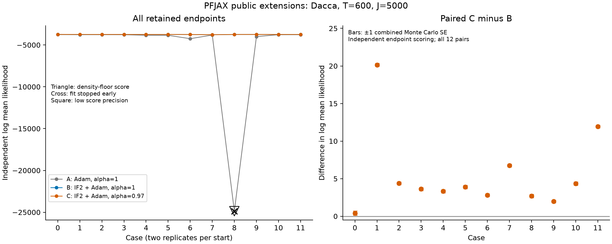
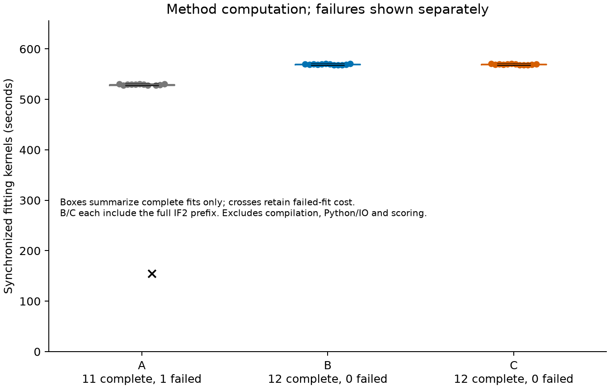
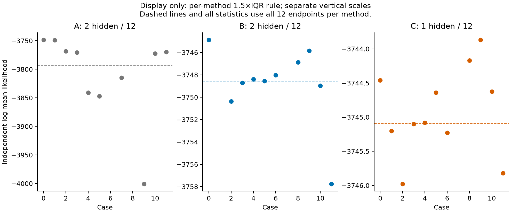

# PFJAX public extensions: Dacca A/B/C

All twelve planned cases and 36 retained endpoints have been audited. C has a higher independently estimated log likelihood than B in all twelve pairs: the median paired difference is 3.762021, with range 0.407534–20.147663. B exceeds A in eleven pairs, and is worse in case1. These are observations from six fixed starts and two replicates per start; they do not establish a general optimizer ranking.

| Method | Complete fits | Nonfloor scores meeting precision | Median log mean likelihood, all 12 | Median fitting kernels, complete fits (s) |
|---|---:|---:|---:|---:|
| A: Adam, α=1 | 11/12 | 11/12 | -3793.495698 | 529.630 (n=11) |
| B: IF2 + Adam, α=1 | 12/12 | 12/12 | -3748.631853 | 569.591 (n=12) |
| C: IF2 + Adam, α=0.97 | 12/12 | 12/12 | -3745.089672 | 569.732 (n=12) |

A includes one failed fit and its density-floor score. The median over the eleven complete A fits is −3772.480315. B and C each completed twelve fits. The failed A calculation used 154.550 fitting-kernel seconds; it is excluded from the successful-fit timing median and retained in the cost totals. B/C each include 175 IF2 passes before 400 Adam updates, while A has only the 400-update phase, so A/B have different total work.

[All 36 scores, failures and times](../../results/pfjax/endpoints.csv) · [Total audit](../../results/pfjax/final_audit_20261101.json) · [Statistics](summary.json) · [Chinese supplementary report](report_CN.md)

## Methods and actual calls

The original Dacca model has 600 monthly observations and 20 Gaussian Euler steps per month. Every fit and final PF evaluation uses 5,000 particles. The 23 updated coordinates consist of 18 process/observation coordinates and five normalized initial-value coordinates. The latter have a redundancy; these are not 23 independently identifiable parameters. Six common starts are each run twice on one A40 GPU per case, in float32.

The pinned original PFJAX revision is `97652aa1bdff73a92c0286549b010e99cc6f7264`. The [seven-file package diff](../../packages/pfjax/review/full.patch) adds `iterated_filter_step`, `iterated_filter` and `particle_filter_mop`, and an initial-particle argument to the original `particle_filter`. The full original PF loop is reused; model callbacks supply general parameter perturbations. The resampling derivative correction at α=1 is also our addition, not an original PFJAX ADPF. These changes have not been accepted upstream.

The formal driver calls `pfjax.iterated_filter_step` 175 times, passes the whole final parameter swarm to the next call and enables within-pass geometric cooling (`cooling_rate=.5`, `cooling_interval=50`). It then calls `pfjax.particle_filter_mop` inside `jax.value_and_grad`, with external Optax `scale_by_adam`. `checkpoint=True` is unchanged. A starts from the original parameter vector with α=1. B starts from the IF2 endpoint with α=1. C starts from that same IF2 endpoint with α=.97. B/C initial parameters, zero Adam state, learning-rate schedule and training iteration keys match exactly. Method order rotates ABC/BCA/CAB across cases. IF2 is computed once physically; both B and C receive its full cost when reporting method computation.

The final 5000×23 IF2 swarm and the acceptance/log-likelihood trace of all 175 passes are saved for each case. Intermediate full particle swarms from every pass are not saved. All Adam traces, final states and the rejected proposal are retained. Failed fits are not retried, and the final point is the last accepted iterate, not a point chosen by training loss or independent score.

## Independent scores, failures and floor values

All 1,548 original PF values were recomputed into their saved summaries without calling a PF again. The fixed original PyPOMP PF uses J=5000 and independent scoring root95081000, separate from training root25081000. Scoring uses `log(mean likelihood)` and the preset R=36→72→144→288 rule, requiring MCSE≤1 and likelihood ESS≥10. Fixed method codes A0/B1/C2 are independent of execution order. The scorer SHA256 is `8aec1ba02982a1ad9bff227b300806eaafa972a1e9fd00b71bef2c5f0ebdc508`.

There are 35 nonfloor scores meeting precision. Case6 A required R=288 and reached MCSE0.275928 and ESS12.603357. The other 35 endpoints use R=36, including the floor endpoint. Case8 A failed after 116 accepted updates. At rejected zero-based update116, its saved loss is finite (41.446716), all 23 gradient entries are NaN, all 23 proposed parameters are NaN, the 46 Adam moments are NaN, and 23 of 28 proposed natural parameters are NaN. The last accepted parameters and optimizer state were retained. The responsible underlying operation has not been established.

Case8 A's independent PF returns the same floor value in all 36 evaluations: log mean likelihood −24867.998047, MCSE0 and ESS36. Its numerical precision flag is therefore true, but this is a density-floor result, not meaningful high-precision evidence of a good fit. It remains marked as both a failed fit and a floor score. No fit or score was rerun.

| Case (start, replicate) | A | B | C | Allocation GPU seconds |
|---|---:|---:|---:|---:|
| 0 (0, 0) | -3748.379732 | -3744.866357 | -3744.458823 | 1816 |
| 1 (0, 1) | -3749.071657 | -3765.349800 | -3745.202137 | 1891 |
| 2 (1, 0) | -3768.404288 | -3750.366905 | -3745.978040 | 1746 |
| 3 (1, 1) | -3770.620974 | -3748.716738 | -3745.099211 | 1718 |
| 4 (2, 0) | -3840.773042 | -3748.398029 | -3745.080133 | 1739 |
| 5 (2, 1) | -3847.215975 | -3748.546967 | -3744.640453 | 1696 |
| 6 (3, 0) | -4247.885292 | -3748.030237 | -3745.228729 | 1700 |
| 7 (3, 1) | -3814.511080 | -3780.893273 | -3774.132663 | 1708 |
| 8 (4, 0) | -24867.998047 † | -3746.878622 | -3744.171275 | 1313 |
| 9 (4, 1) | -4000.784993 | -3745.841153 | -3743.867590 | 1693 |
| 10 (5, 0) | -3772.480315 | -3748.977166 | -3744.625940 | 1711 |
| 11 (5, 1) | -3769.827657 | -3757.758905 | -3745.819392 | 1750 |

† Failed A fit with a density-floor score. The all-endpoint statistics include it. Complete, precise, nonfloor paired subsets are also reported in summary.json: B−A is positive in 10/11, with median23.503149; C−A in 11/11, with median27.854376. These subsets supplement rather than replace the full records.

## Figures

The left panel retains every endpoint, including the floor. The right panel contains all twelve C−B pairs; error bars show ±1 combined Monte Carlo SE from independent endpoint scoring. They are not between-start uncertainty or a general population interval. [PDF](endpoints.pdf).

Boxes use complete fits only; the cross retains the failed-fit cost. B/C each include the full IF2 prefix. Kernel times exclude compilation, Python/IO and independent scoring. Shared compilation is not used to rank individual arms. [PDF](timing.pdf).

This display alone hides values outside each method's Q1−1.5IQR to Q3+1.5IQR range: A cases6/8, B cases1/7 and C case7. Vertical scales differ. All tables, medians and paired statistics retain all twelve endpoints per method. [PDF](likelihood_iqr.pdf).

## Cost and validation limits

The twelve formal allocations used 20,481 GPU seconds (5.689 GPU hours), including fitting, compilation, scoring and process overhead. Three prior checks charged to this experiment used 293, 194 and 354 seconds. Their combined 21,322 seconds stay below the original 42,480-second (11.8-hour) budget. These are summed resource seconds, not the elapsed waiting time of parallel jobs. The previous shared Cuthbert/PFJAX validation job and its ordinary-PF timing records remain separate history; its entire allocation is not assigned again to PFJAX.

The earlier [ordinary PF measurement](../timing.md) is 0.220416 seconds, median of seven A40 T600/J5000/B1 calls; compilation was 4.864631 seconds. It was not remeasured and is not an optimizer-speed claim.

The [old full-Dacca check](../pfjax_forward_20261101.md) remains failed: original forward-only evaluation and the public differentiated evaluation differed by 11–112 log-likelihood units at four of twelve starts/keys. The [execution controls](../pfjax_execution_controls_20261101.md) subsequently found 324/324 exact original/public forward matches when execution mode was matched, at cases0/2/11 with repeats and both checkpoint settings. The original code itself reproduced the forward-only versus differentiated discrepancy at cases0/11. These controls do not cover every execution variant at all twelve cases or identify the underlying GPU operation. The empirical experiment follows the user's likelihood-based acceptance decision; neither this comparison nor restoration of its files certifies mathematical gradients or makes the earlier failures pass.

The total audit rechecked all twelve original collections, 113 frozen driver/source files and 394 referenced package/validation files; full swarms, optimizer state, paired initialization, scores, failures and Slurm costs. It checked 1,627 distinct scoring roots/chunks/PF-repeat keys against 6,936 training roots/IF2-pass/gradient-iteration keys and found no cross-stream collision. This scope does not enumerate every internal model draw. The same gradient stream within each case is intentional pairing.

## Code and saved-data reproduction

[Package source details](../../packages/pfjax/README.md) · [Analysis program](../../scripts/analyze_pfjax.py) · [Archive catalog](../../archive/catalog.json)

`artifacts/experiments/dacca/pfjax_review_20261101.tar.gz` contains all twelve original collections, frozen sources and references, original/candidate package trees, the readable package diff and driver-recording diff, failed validation records, raw scores, environment records, auditors and reports. Its FILES_SHA256.json covers every other member. See its README for commands to recheck saved arrays and regenerate figures without fitting or making a PF call. The archive is for local author review, not an upstream release. Historical launchers retain their original paths and must not be blindly resubmitted.
