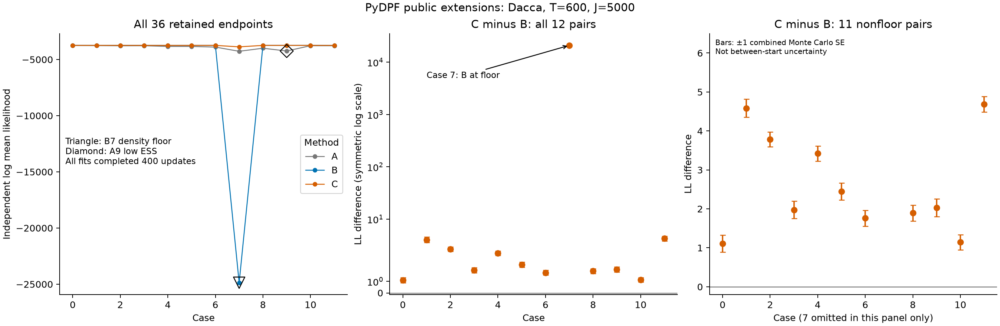
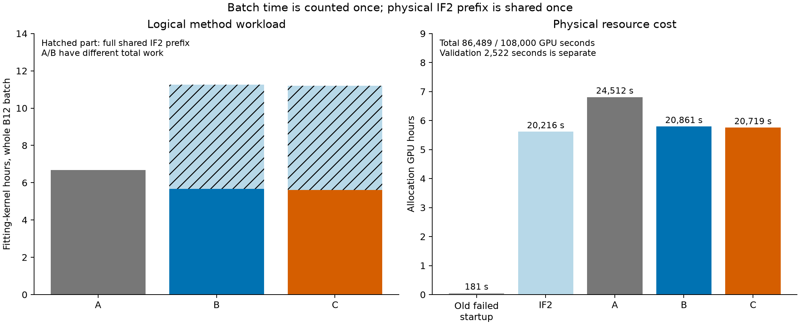
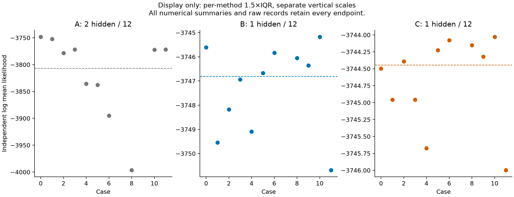

# PyDPF: IF2 initialization and gradient discounting on Dacca

All 36 planned fits completed 400 accepted Adam updates. The complete source, saved-state, pairing, random-stream, independent-score and resource audit passed. The 1,548 saved original PF values give 34 precise nonfloor scores, one low-ESS A score and one B density-floor score. There were no rejected proposals, failed fits or batch execution exceptions; a completed fit does not guarantee a useful endpoint.

C has higher estimated log mean likelihood than B in all twelve paired cases. The all-pair median C−B is 2.240650. Case 7 contributes an unusually large difference of 20,993.210336 because B is at the density floor. Among the eleven pairs with precise nonfloor scores in both arms, all differences are positive: median 2.031365, range 1.109046–4.688133. These observations cover six starts and two repetitions, and do not establish universal superiority or statistical significance across models and starts.

| Method | Complete 400-update fits | Median log mean likelihood, all endpoints | Precise nonfloor scores |
|---|---:|---:|---:|
| A | 12/12 | -3806.946514 | 11/12 |
| B | 12/12 | -3746.804253 | 11/12 |
| C | 12/12 | -3744.445235 | 12/12 |

B exceeds A in eleven of twelve pairs, with all-pair median difference 28.643451; B case 7 is worse by 20,599.161966. C exceeds A in all twelve pairs, with median difference 61.913803. The precise nonfloor subsets are explicitly recorded in [summary.json](summary.json), alongside the complete statistics. A and B have different total workloads. B/C share the same IF2 endpoints, empty Adam state, learning rates and training streams; their comparison isolates the recorded discounting change within this setup.

The left and middle panels retain all endpoints and pairs. The middle panel uses a symmetric logarithmic vertical scale. The right panel omits only the B-floor pair to display the eleven ordinary differences. Bars are ±1 combined Monte Carlo standard error from the two independent scores; they are not intervals for variability across starts or training runs.

## Calls and scientific settings

The experiment uses original Dacca, T=600 monthly observations, twenty Gaussian Euler steps per month and J=5,000 particles. The 23 updated coordinates contain eighteen process/observation coordinates and five normalized initial-state coordinates with redundancy, not 23 independently identifiable parameters.

- A: original starting vector, alpha=1, 400 Adam updates.
- B: 175 public IF2 passes, then alpha=1 and 400 Adam updates.
- C: the same physical IF2 endpoint, then alpha=0.97 and 400 Adam updates.

The pinned upstream PyDPF revision is `a7487ce1c344c70e1a244e75725b950deb15e146`. The full original `ParticleFilter`/`SIS.forward` and `StopGradientDPF` are used. Public `IteratedFiltering` and the discount argument are local additions; they are not upstream-native IFAD functions. The optimizer is external `torch.optim.Adam`. IF2 uses cooling rate 0.5, interval 50 and within-pass cooling. These perturbation/cooling details differ between packages.

Float32 arithmetic, systematic resampling, checkpointing and default nondeterministic production execution remain unchanged. Adam uses beta1=0.9, beta2=0.999 and epsilon=1e-8, the frozen coordinate rates, ten-step learning-rate warmup and cosine floor 0.05, without gradient clipping. The small GPU resume checks use deterministic operations only in their separate test process; production settings were not changed to match that test.

The twelve physical IF2 fits completed 175 passes each, totaling 2,100 accepted passes without failure. Final 5,000-by-23 parameter swarms, 176 mean-history entries, 175 likelihood entries and generator bytes per row are retained. Every intermediate swarm and every successful Adam proposal were not saved. No best-training-loss selection, numerical retry or repeated independent scoring was performed.

## Independent evaluation and retained limitations

The independent evaluator is the fixed original PyPOMP PF at J=5,000, SHA256 `8aec1ba02982a1ad9bff227b300806eaafa972a1e9fd00b71bef2c5f0ebdc508`. It reports log(mean likelihood), increasing R through 36, 72, 144 and 288 until MCSE <= 1 and likelihood ESS >= 10. Training root 24781000 and scoring root 94781000 remain separate; scoring uses typed JAX keys with A=0, B=1 and C=2.

A case 9, start 4 repetition 1, reached R=288 and remains low precision: LL=-4243.528972, MCSE=0.917676 and ESS=1.186695. The MCSE criterion alone passes, but ESS does not. The endpoint and all repeats remain in every full statistic. It is not rescored or described as a precise estimate.

B case 7, start 3 repetition 1, completed 400 updates with finite accepted parameters and optimizer states. Its 36 independent PF values all equal the density floor, -24867.998046875. MCSE=0 and ESS=36 mechanically satisfy the numerical formula; this is neither a meaningful high-precision likelihood estimate nor a good fit. It is not reclassified as an optimizer failure. The records do not identify a specific underlying operation as the cause of this poor endpoint.

C case 7 scores -3874.787711, with MCSE=0.270386 and ESS=10.115754; it meets the stated criteria but remains worse than C's other eleven endpoints. All C scores use R=36. Every score other than A case 9 also stops at R=36, giving 684 A, 432 B and 432 C raw values. There are no nonfinite raw scores. Of 35 numerical precision flags, one is the B floor: the useful count is 34 precise nonfloor scores, plus one low-ESS score and one floor score.

## Fitting time and resource cost

| Stage | Gradient kernel seconds, whole B12 batch | Logical fitting kernel seconds, including IF2 for B/C | Slurm GPU seconds |
|---|---:|---:|---:|
| Earlier failed startup | — | — | 181 |
| Shared physical IF2 | — | 20113.891332 | 20216 |
| A | 24031.036436 | 24031.036436 | 24512 |
| B | 20411.693553 | 40525.584884 | 20861 |
| C | 20170.607658 | 40284.498990 | 20719 |

These kernel times belong to entire twelve-member batches, not individual endpoints. They must not be multiplied by twelve. A/B/C gradient-stage wall times were 24,327.470423 / 20,662.389858 / 20,402.770063 seconds; synchronized kernel times exclude host checks and checkpoint I/O. Logical B/C costs each include the full IF2 prefix, while physical accounting counts that shared prefix once. B's gradient stage is faster than A's, but its full logical fitting workload is larger.

The four successful formal allocations used 86,308 GPU seconds. Adding the earlier failed startup gives 86,489 seconds (24.0247 GPU hours), within the original 108,000-second allowance. Earlier validation used another 2,522 seconds separately, for 89,011 seconds including validation. Preparation, compilation, Python/I/O and scoring are components of allocations, not extra charges. Slurm ElapsedRaw measures resource use; summing concurrent allocations is not wall-clock waiting time.

The earlier ordinary-PF timing was an upstream median 8.57610 seconds and candidate median 8.56534 seconds over nine paired A40 T600/J5000 calls, with all 600 likelihood increments matching. It was not repeated here. Ordinary PF speed, full batched differentiation and optimization quality are different measured quantities; see [PF runtime](../timing.md).

## Source, saved-state and pairing audit

The formal source contains 160 frozen files, manifest SHA256 `7fac0cfd6df9c93e383a719d64ef2bd71e47c9ae4af6fd4a410babd91633b58e`. The warm collection has 138 transferred and 134 terminal files; each gradient collection has 534 transferred and 530 terminal files. All source, complete file sets and hashes, jobs/nodes, unique launches and single scoring attempts were checked. Warm job 65170880 and A/B/C jobs 65177901/65177902/65177903 all completed with exit 0:0.

The aggregate audit re-reads all actual phase records. It verifies all 36 identities, initial/final parameters and Adam states, 400 event records per phase, finite accepted states, learning-rate settings, the same physical warm source, and the original raw statistics and adaptive stopping. B/C initial parameters and empty Adam states match; all 400 paired training seeds and recorded generator-after hashes match. The audit checks 812 distinct planned Torch seeds (twelve IF2 seeds, 400 A seeds and 400 deliberately shared B/C seeds) and 1,627 independent JAX scoring keys. Torch and JAX are different generator spaces; these checks neither equate the spaces nor enumerate internal random draws.

Earlier failures remain unchanged. The original full-Dacca check 65169994 failed its ordinary-PF versus native-DPF equality requirement, with maximum summed-log-likelihood difference 558.884766. In the same records, all 48 native-StopGradientDPF/public forward and final-RNG comparisons match exactly. The underlying ordinary-PF/DPF discrepancy remains unexplained. The user accepted matching native-DPF/public forward calculations for the empirical optimization comparison; this does not certify mathematical derivatives.

The first warm startup, 65170442, failed after 181 GPU seconds in the small optimizer-resume check, before any formal IF2 call. Parameters and RNG matched but Adam moments differed; that failed allocation is charged and retained. The revised test uses deterministic operations in its own child process without altering the production process. No completed formal IF2 run was repeated. Earlier default/self-repeat, extension-test and recovery failures also remain in the archived history; they are not relabeled as successes.

## Display and reproduction

The separate per-method 1.5×IQR display hides A cases 7 and 9, B case 7 and C case 7. It uses separate vertical scales and retains all twelve values when drawing each median. All 36 endpoints remain in the full plot, numerical summaries, [CSV](../../results/pydpf/endpoints.csv), [current JSON](../../results/pydpf/current_results.json) and [final audit](../../results/pydpf/final_audit_20261102.json). Vector PDFs accompany all three PNGs, which were visually inspected. [Chinese supplementary notes](report_CN.md) summarize the findings.

The complete local archive `artifacts/experiments/dacca/pydpf_review_20261102.tar.gz` is indexed with its SHA256 in the [catalog](../../archive/catalog.json). It retains all four original collections, full frozen source and original scorer reference source, original/candidate package code, readable package/driver diffs, environments, submission records, validation failures, raw scoring and saved-data audit/plot programs. Its README explains the extracted layout and the separate Torch, JAX and plotting dependency paths. Verification checks every archive member, reproduces saved phase/aggregate audits and all summary/figure files, and applies the readable eight-file package patch to restore all thirty candidate files. These checks execute no PF or optimizer. They do not promise portable bitwise GPU reruns or imply upstream release.

## All retained endpoints

All rows completed 400 accepted updates. The last column describes independent scoring, not optimizer completion.

| Method | Case | Start | Repetition | Log mean likelihood | MCSE | Likelihood ESS | R | Score status |
|---|---:|---:|---:|---:|---:|---:|---:|---|
| A | 0 | 0 | 0 | -3748.203606 | 0.144946 | 20.745382 | 36 | precise |
| A | 1 | 0 | 1 | -3752.106595 | 0.183683 | 16.507089 | 36 | precise |
| A | 2 | 1 | 0 | -3778.475532 | 0.103262 | 26.216058 | 36 | precise |
| A | 3 | 1 | 1 | -3771.726493 | 0.195412 | 15.407603 | 36 | precise |
| A | 4 | 2 | 0 | -3835.417497 | 0.110101 | 25.275896 | 36 | precise |
| A | 5 | 2 | 1 | -3837.730408 | 0.102161 | 26.367988 | 36 | precise |
| A | 6 | 3 | 0 | -3895.050354 | 0.218087 | 13.510145 | 36 | precise |
| A | 7 | 3 | 1 | -4268.836081 | 0.128594 | 22.802554 | 36 | precise |
| A | 8 | 4 | 0 | -3996.401010 | 0.082929 | 29.015824 | 36 | precise |
| A | 9 | 4 | 1 | -4243.528972 | 0.917676 | 1.186695 | 288 | low ESS |
| A | 10 | 5 | 0 | -3772.160287 | 0.148603 | 20.305700 | 36 | precise |
| A | 11 | 5 | 1 | -3771.722600 | 0.155389 | 19.511177 | 36 | precise |
| B | 0 | 0 | 0 | -3745.607147 | 0.117711 | 24.243114 | 36 | precise |
| B | 1 | 0 | 1 | -3749.542434 | 0.201265 | 14.889782 | 36 | precise |
| B | 2 | 1 | 0 | -3748.176674 | 0.119382 | 24.018892 | 36 | precise |
| B | 3 | 1 | 1 | -3746.933867 | 0.192692 | 15.655154 | 36 | precise |
| B | 4 | 2 | 0 | -3749.094339 | 0.171898 | 17.697255 | 36 | precise |
| B | 5 | 2 | 1 | -3746.674639 | 0.132157 | 22.342351 | 36 | precise |
| B | 6 | 3 | 0 | -3745.837882 | 0.138452 | 21.545073 | 36 | precise |
| B | 7 | 3 | 1 | -24867.998047 | 0.000000 | 36.000000 | 36 | floor |
| B | 8 | 4 | 0 | -3746.047212 | 0.144846 | 20.757545 | 36 | precise |
| B | 9 | 4 | 1 | -3746.353719 | 0.132017 | 22.360318 | 36 | precise |
| B | 10 | 5 | 0 | -3745.172243 | 0.133787 | 22.133869 | 36 | precise |
| B | 11 | 5 | 1 | -3750.685228 | 0.151497 | 19.963488 | 36 | precise |
| C | 0 | 0 | 0 | -3744.498100 | 0.186567 | 16.228955 | 36 | precise |
| C | 1 | 0 | 1 | -3744.956880 | 0.121767 | 23.700491 | 36 | precise |
| C | 2 | 1 | 0 | -3744.392371 | 0.149212 | 20.233326 | 36 | precise |
| C | 3 | 1 | 1 | -3744.956975 | 0.114356 | 24.696322 | 36 | precise |
| C | 4 | 2 | 0 | -3745.673052 | 0.094438 | 27.435971 | 36 | precise |
| C | 5 | 2 | 1 | -3744.224703 | 0.173480 | 17.532398 | 36 | precise |
| C | 6 | 3 | 0 | -3744.078751 | 0.155570 | 19.490294 | 36 | precise |
| C | 7 | 3 | 1 | -3874.787711 | 0.270386 | 10.115754 | 36 | precise |
| C | 8 | 4 | 0 | -3744.152291 | 0.143148 | 20.964438 | 36 | precise |
| C | 9 | 4 | 1 | -3744.322354 | 0.185289 | 16.351600 | 36 | precise |
| C | 10 | 5 | 0 | -3744.028304 | 0.142538 | 21.039123 | 36 | precise |
| C | 11 | 5 | 1 | -3745.997094 | 0.128776 | 22.778883 | 36 | precise |
