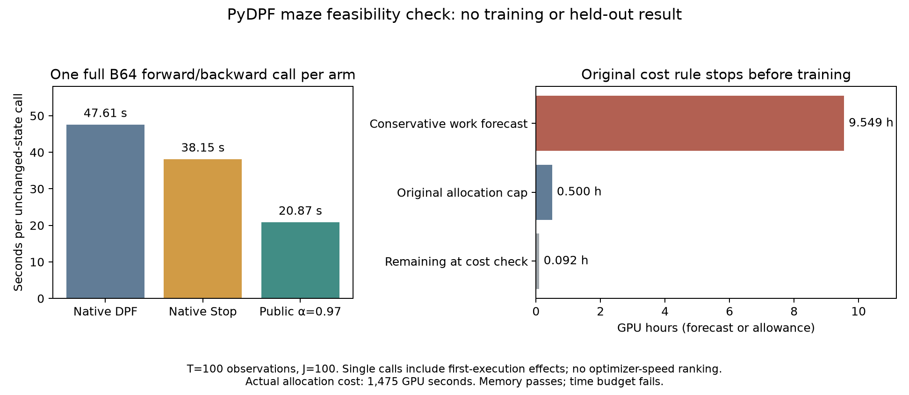

# PyDPF maze pilot: forward checks pass, training exceeds the time allowance

The bounded pilot stopped at its predefined cost check. No model was trained, no AdamW update was made, and no held-out localization RMSE is available. Job 65185523 ended FAILED 1:0 on one A40 GPU (gl1511), using 1,475 of its 1,800 allocated seconds. This is a verified budget limitation, not a completed comparison of robotics performance.

Ten full-length T=100/J=100/B2 control calls were finite, covering five filter variants at model seeds 0 and 10. All eight recorded matched forward pairs were exactly equal, with matching initial states and before/after generator states. Native Stop-Gradient and public α=1 also had identical saved gradients at both initializations; native DPF and public α=0 did too. Public α=0.97 changed gradients while preserving the compared forward values. This is evidence for these checks, not a mathematical derivative certification or evidence of improved training.

## Measured cost and the stopping decision

| Filter | One B64 forward/backward call, seconds | One inference call, seconds | Peak allocated GPU bytes |
|---|---:|---:|---:|
| Native DPF | 47.612866 | 0.363119 | 5755735552 |
| Native Stop-Gradient | 38.154023 | 0.365054 | 5763261952 |
| Public α=0.97 | 20.873623 | 0.365147 | 5763261952 |

Each is one unchanged-state call, with no optimizer step. Different first-execution costs and fixed order affect these measurements; they are not a reliable optimizer-speed ranking. The inference calls use each corresponding filter on the same training batch. They are not the planned independent ordinary-PF evaluations of trained models on the held-out set.

The frozen forecast uses the largest measured forward/backward and inference times, a 1.5 safety factor, twelve process-overhead allowances, and a 240-second reserve. Six fits × five epochs × fifteen training batches plus seven validation batches per epoch, and thirty-three test calls per fit, produce a forecast of **34,374.758986 seconds (9.548544 hours)**. Only **330.427727 seconds** remained at the check. The memory threshold passed; the time threshold failed. The script preserved this failed check and exited before the training loop. The forecast is not consumed compute, and the allocation cost must not be added to its component timings.

The original 30-minute cap was not enlarged, and no smaller replacement or retry was run. A future training experiment would require a separately specified budget and protocol. This pilot supplies no learning curve or test RMSE to plot, so the figure displays the measurements that actually exist.

## Intended comparison and its limits

This separate experiment followed Ed's suggestion to explore the authors' maze example. It uses their model classes from `replication_materials/run_experiments.py`, original observation encoder/decoder, state encoder, normalizing flow, dynamics/prior, complete PyDPF `DPF`, `StopGradientDPF` and `ParticleFilter`. The existing public `StopGradientDPF(alpha=.97)` extension discounts inherited log-weight derivatives; it does not detach every state-path derivative. `worker.py` adds the recorded outer loop and uses the original AdamW settings. This is neither a PyPOMP port nor IFAD/MLE.

The planned loss combines position, sine/cosine orientation, and autoencoder reconstruction errors. It is not a likelihood for the original image observations. The proposed three methods were native DPF, native Stop-Gradient and public α=0.97, at two shared model seeds and five epochs each. There was no test-based alpha search. Validation would select the best checkpoint, followed by three new paired ordinary-PF streams on all 700 held-out trajectories. None of those training or held-out stages ran.

The authors' CSV is [Zenodo record 23039951](https://doi.org/10.5281/zenodo.23039951), 1,197,888,679 bytes, MD5 `9e133f441d829cc0e15601e919cd267b`, SHA256 `481223e5c6a6e3d7a947b1396a0efa6cd8b36d6e2304c931c477aa19d5b3b0cb`. The recorded upstream commit is `a7487ce1c344c70e1a244e75725b950deb15e146`. The fixed 900/400/700 split has 2,000 unique, disjoint trajectory IDs and matches seed 20261101. Original global image normalization includes unlabelled held-out images; this is disclosed and shared across arms. Labels from test trajectories do not enter training or model selection. Strict deterministic mode is specific to this pilot and does not change Dacca's production settings.

## Audit and reproduction

The [saved-data audit](../../results/pydpf_maze/audit_20261101.json) independently verifies 61 frozen source files, all transferred and terminal files, the failed Slurm exit, launch identity, data metadata, split, all control tensors/gradients/initial models, zero optimizer state, recorded costs and the original forecast arithmetic. It reproduces the original GPU control-audit JSON exactly and confirms the absence of training, fit-complete and test directories. No model, PF or optimizer is called by this audit. The density/gradient checks and budget result remain separate from optimization effectiveness, which was not measured.

The terminal record is present despite the failed allocation. The regenerable 1.4 GB prepared-tensor cache and full CSV are not copied into the review archive; their original checksum, preparation code and split metadata are retained. All actual saved gradients, initial checkpoints, control/cost arrays, logs and failure records are included. There are no trained checkpoints or test predictions to omit. Earlier small CPU checks and local import/cache failures are kept separately and do not substitute for this GPU outcome.

The local archive `artifacts/experiments/maze/pydpf_maze_pilot_20261101.tar.gz` is indexed in the [archive catalog](../../archive/catalog.json). Its extracted saved-data audit and plot/summary reproduction are checked without refitting or PF evaluation. [Protocol](../../results/pydpf_maze/protocol_20261101.json), [summary](summary.json), [Chinese supplementary report](report_CN.md), and the PDF figure accompany this report. The separate Dacca comparison and its running PyDPF jobs are unchanged; these 1,475 seconds are not charged to Dacca.
