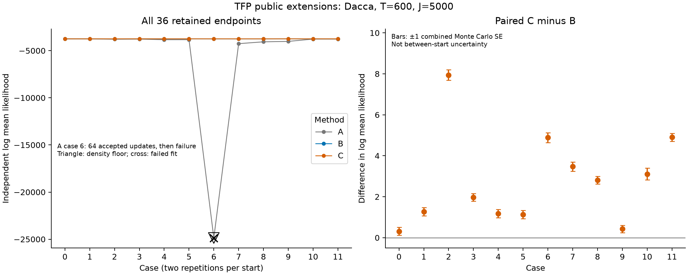
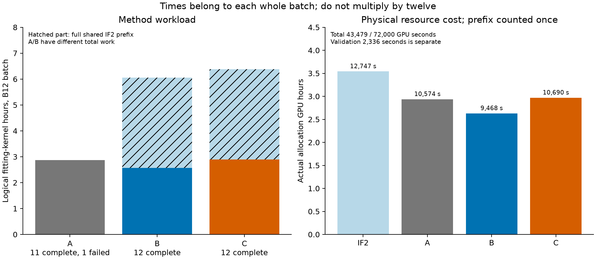
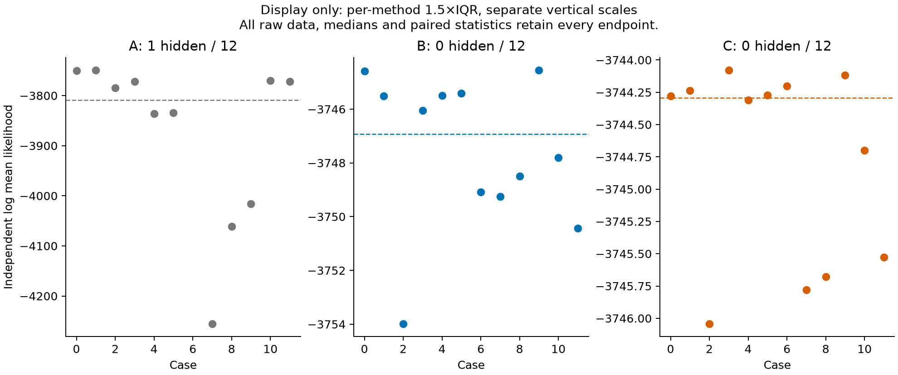

# TFP: IF2 initialization and gradient discounting on Dacca

All 36 planned endpoints and 1,332 original independent PF values have been audited. Thirty-five fits completed 400 Adam updates. A case 6 stopped after 64 accepted updates and its retained endpoint scored at the density floor. The other 35 scores meet the recorded precision criteria. No failed fit or floor score was removed or rerun.

C has a higher estimated log mean likelihood than B in all twelve paired cases: median difference 2.391187, range 0.314946–7.943847. B also exceeds A in all twelve cases. These are observations from six starts with two repetitions per start, not a claim of universal optimizer superiority. B/C share the same IF2 endpoint, zero Adam state, learning rates and training streams. A begins at the original start and uses less total work.

| Method | Complete fits | Median LL, all endpoints | Median LL, complete fits | Precise nonfloor scores |
|---|---:|---:|---:|---:|
| A | 11/12 | -3809.127311 | -3784.177843 | 11/12 |
| B | 12/12 | -3746.926753 | -3746.926753 | 12/12 |
| C | 12/12 | -3744.294332 | -3744.294332 | 12/12 |

For the eleven pairs where both fits completed with precise nonfloor scores, median B−A is 30.191280 and median C−A is 38.135127. The all-endpoint statistics retain the failed A endpoint. These likelihood estimates have Monte Carlo uncertainty; an observed positive difference is not by itself a significance test.

The left panel retains the floor score. Error bars on C−B are ± the square root of the two recorded MCSE squares, as a descriptive scoring-uncertainty summary. They are not intervals for variability across starts or repeated training runs.

## Calls and settings

This is original Dacca: T=600 monthly observations, twenty Gaussian Euler steps per month, J=5,000 particles, and 23 updated coordinates. Eighteen are process/observation coordinates; five are normalized initial-state coordinates with redundancy. They are not 23 independently identifiable parameters.

- A: original start, gradient discount α=1, 400 Adam updates.
- B: 175 public IF2 passes, then α=1 and 400 Adam updates.
- C: the same physical IF2 endpoint, then α=0.97 and 400 Adam updates.

The modified TFP 0.25.0 package calls the complete original `tfp.experimental.mcmc.particle_filter` and SMC implementation. The public `iterated_filter_step` and `gradient_discount` argument/wrapper are our additions. The driver uses external `tf.keras.optimizers.Adam`; this is not an upstream-native IFAD routine. IF2 uses cooling rate 0.5, interval 50 and within-pass cooling. Perturbation and cooling details differ between packages, so the package experiments are not identical IF2 algorithms.

Production float32, checkpointing, default nondeterministic execution and XLA=False are unchanged. The original package diff changes seven files. The later driver/API diff adds rejected-proposal recording and checks the already completed physical prefix before a unique launch. The frozen gradient revision cannot run IF2. All twelve physical IF2 fits completed 175 accepted passes, giving 2,100 accepted passes and no IF2 failure.

## The failed fit and independent scoring

A case 6 (start 3, repetition 0) rejected zero-based update 64 after 64 accepted updates. The saved loss is finite, 41.446533203125. All 23 gradient entries are NaN. The 23 proposed parameters, 28 transformed natural parameters and 46 proposed Adam moment values are finite. The API replaces invalid row gradients with zero before calling Adam, then restores that row's parameters and moments. Consequently a finite proposal does not imply a finite original gradient. Other batch members continue; shared optimizer counters may advance.

The original phase audit field named `finite_loss` checks loss and gradient jointly. Its bytes remain unchanged. The [additional raw-field audit](../../results/tfp/rejected_proposal_20261101.json) distinguishes the two and verifies parameter rollback. It does not identify the underlying GPU operation that produced the NaNs. No retry was made, and the last valid parameters were evaluated without choosing the best training loss or independent score.

The fixed original PyPOMP PF evaluates each endpoint independently with J=5,000. Its SHA256 is `8aec1ba02982a1ad9bff227b300806eaafa972a1e9fd00b71bef2c5f0ebdc508`. Training root 24881000 and scoring root 94881000 are separate. The scorer uses typed JAX keys and fixed method codes A=0, B=1, C=2. It estimates log(mean likelihood), with R=36,72,144,288 until MCSE ≤ 1 and likelihood ESS ≥ 10.

A case 7 required R=72 (MCSE 0.243426, ESS 13.827055). Every other score stopped at R=36. A case 6 has 36 identical floor values, LL=−24867.998047, MCSE=0 and ESS=36. That numerical precision flag is not evidence of a good fit or meaningful high precision. There are 35 precise nonfloor scores and one floor score, no nonfinite raw scores and no retained low-precision endpoints.

## Time and resource cost

| Stage | Gradient kernel seconds, whole B12 batch | Logical fit kernel seconds, including prefix for B/C | Slurm GPU seconds |
|---|---:|---:|---:|
| Physical IF2 prefix | — | 12561.816785 | 12747 |
| A | 10348.494746 | 10348.494746 | 10574 |
| B | 9229.294115 | 21791.110900 | 9468 |
| C | 10429.009462 | 22990.826247 | 10690 |

These fitting times belong to entire twelve-member batches. They are not per-endpoint times and must not be multiplied by twelve. A includes one failed member, whose individual elapsed fit time cannot be recovered from batch timing; its early stop is not counted as successful acceleration. B/C logical costs each include the full prefix, while physical accounting counts that shared prefix once.

Formal allocations used 43,479 GPU seconds, within the original 72,000-second (20 GPU-hour) allowance. Earlier validation used 2,336 seconds separately, giving 45,815 seconds including validation. Graph construction, warmup, Python/I/O and scoring are within the allocations; kernel times exclude some of these components and are not extra resource charges. Slurm ElapsedRaw is authoritative. Resource seconds summed across concurrent jobs are not wall-clock waiting time.

The earlier ordinary-PF measurement was a median 6.278312 seconds over seven T=600/J=5000/B1 A40 calls, with warmup separate. It was not repeated here. That quantity is distinct from batched differentiation, optimization quality and full allocation cost; see [ordinary PF timing](../timing.md).

## Audit, limitations and previous failures

The saved-data audit verified both frozen sources (3,144 prefix files and 3,106 gradient files), all transfer and terminal file lists/hashes, jobs/nodes, unique launch records and one scoring attempt per phase. Prefix job 65171217 and gradient jobs A=65177155, B=65177156, C=65177157 all have Slurm COMPLETED 0:0; A's numerical fit failure remains a failure despite its successful allocation exit.

The complete audit rechecks the actual prefix and all three actual phase audits, all 36 endpoint identities, 95 B/C initial arrays and canonical zero Adam state, learning rates, accepted counts, final parameters and optimizer states, the full rejected proposal and rollback, all raw score statistics and actual resource costs. Final IF2 clouds are complete 5000×1×23 arrays. Every intermediate cloud and successful Adam proposal was not retained, so the audit does not reconstruct those missing states.

The audit reconstructs 11,724 planned TensorFlow root/member tuples: 2,100 IF2 calls, 4,800 A calls, 4,800 deliberately shared B/C calls, and two warmup groups of twelve. It pairs 4,800 actual common B/C call tuples. Planned calls do not imply that a failed member executed all updates, and successful runtime keys were not separately saved for every call. The 1,405 independent JAX scoring keys are checked separately for uniqueness. TensorFlow and JAX are different generator spaces; this is not a cross-backend same-key-space collision test or an enumeration of internal random draws.

Earlier failures remain unchanged. The original 701-second full-Dacca check had 72 exact forward pairs and finite filter/gradient, IF2 and Adam checks, but failed its original time allocation. A separate revision redistributed the same 20-hour total to 21,600 seconds for the prefix and 16,800 for each gradient phase, retaining the original cost margins and scientific settings. The earlier 1,203-second diagnosis retained three timeouts. Its available deterministic single-point controls and original self-repeat comparisons do not certify all starts or mathematical derivatives. All 515 CPU file pairs were attempted with corresponding exit/count/failure identifiers, including nine timeouts and one abort; this was not an all-tests-pass result.

The user accepted matching forward calculations for the empirical optimization comparison. Saved-state integrity, observed optimization results and derivative correctness remain distinct questions. No old failed check is relabeled as passed.

## Display and reproduction

The separate 1.5×IQR display hides A case 6 only. No B/C point is hidden. All 36 endpoints remain in every numerical summary, the full-range plot, [CSV](../../results/tfp/endpoints.csv), [current JSON](../../results/tfp/current_results.json), [final audit](../../results/tfp/final_audit_20261101.json) and [summary](summary.json). Vector PDF versions accompany all three PNGs. English is primary; [Chinese supplementary notes](report_CN.md) summarize the findings.

The complete local archive is `artifacts/experiments/dacca/tfp_review_20261101.tar.gz`, indexed with its SHA256 in the [catalog](../../archive/catalog.json). It includes all actual collections, both frozen revisions, original and candidate package code, readable patches, original failures/validation records, environments, scoring records, audit programs and these figures. Its README specifies the extracted directory layout and separate TensorFlow/JAX CPU environments for saved-data auditing. Extraction must reproduce the total audit, summary and six figure files byte for byte in the recorded environment, and applying the seven-file patch must recover all 1,541 candidate files. The external package-verification record states those checks. These operations evaluate no PF and run no optimizer; they do not promise portable bitwise GPU reruns or constitute an upstream release.

## All retained endpoints

| Method | Case | Start | Repetition | Accepted updates | Log mean likelihood | MCSE | Likelihood ESS | Fit / score status |
|---|---:|---:|---:|---:|---:|---:|---:|---|
| A | 0 | 0 | 0 | 400 | -3749.985113 | 0.119245 | 24.037170 | complete |
| A | 1 | 0 | 1 | 400 | -3749.110183 | 0.115051 | 24.602144 | complete |
| A | 2 | 1 | 0 | 400 | -3784.177843 | 0.126928 | 23.019748 | complete |
| A | 3 | 1 | 1 | 400 | -3772.267975 | 0.128629 | 22.797927 | complete |
| A | 4 | 2 | 0 | 400 | -3836.232258 | 0.129434 | 22.693429 | complete |
| A | 5 | 2 | 1 | 400 | -3834.076779 | 0.096854 | 27.101793 | complete |
| A | 6 | 3 | 0 | 64 | -24867.998047 | 0.000000 | 36.000000 | failed; floor |
| A | 7 | 3 | 1 | 400 | -4255.515223 | 0.243426 | 13.827055 | complete |
| A | 8 | 4 | 0 | 400 | -4061.357405 | 0.203829 | 14.669253 | complete |
| A | 9 | 4 | 1 | 400 | -4016.320308 | 0.127555 | 22.937812 | complete |
| A | 10 | 5 | 0 | 400 | -3769.847846 | 0.164416 | 18.498175 | complete |
| A | 11 | 5 | 1 | 400 | -3771.532423 | 0.130471 | 22.559343 | complete |
| B | 0 | 0 | 0 | 400 | -3744.593931 | 0.144097 | 20.848537 | complete |
| B | 1 | 0 | 1 | 400 | -3745.504612 | 0.139228 | 21.448306 | complete |
| B | 2 | 1 | 0 | 400 | -3753.986564 | 0.229983 | 12.626168 | complete |
| B | 3 | 1 | 1 | 400 | -3746.048365 | 0.129981 | 22.622599 | complete |
| B | 4 | 2 | 0 | 400 | -3745.488248 | 0.137291 | 21.690548 | complete |
| B | 5 | 2 | 1 | 400 | -3745.404862 | 0.125461 | 23.212097 | complete |
| B | 6 | 3 | 0 | 400 | -3749.087443 | 0.171397 | 17.749767 | complete |
| B | 7 | 3 | 1 | 400 | -3749.252040 | 0.179458 | 16.923830 | complete |
| B | 8 | 4 | 0 | 400 | -3748.489130 | 0.142830 | 21.003267 | complete |
| B | 9 | 4 | 1 | 400 | -3744.547562 | 0.116195 | 24.447501 | complete |
| B | 10 | 5 | 0 | 400 | -3747.805140 | 0.245664 | 11.567096 | complete |
| B | 11 | 5 | 1 | 400 | -3750.432552 | 0.135951 | 21.859399 | complete |
| C | 0 | 0 | 0 | 400 | -3744.278986 | 0.131234 | 22.460996 | complete |
| C | 1 | 0 | 1 | 400 | -3744.237579 | 0.146861 | 20.514105 | complete |
| C | 2 | 1 | 0 | 400 | -3746.042717 | 0.099719 | 26.705505 | complete |
| C | 3 | 1 | 1 | 400 | -3744.078177 | 0.129235 | 22.719307 | complete |
| C | 4 | 2 | 0 | 400 | -3744.309678 | 0.146782 | 20.523658 | complete |
| C | 5 | 2 | 1 | 400 | -3744.271556 | 0.165358 | 18.395371 | complete |
| C | 6 | 3 | 0 | 400 | -3744.203491 | 0.161773 | 18.789464 | complete |
| C | 7 | 3 | 1 | 400 | -3745.780485 | 0.127005 | 23.009656 | complete |
| C | 8 | 4 | 0 | 400 | -3745.676944 | 0.123571 | 23.461272 | complete |
| C | 9 | 4 | 1 | 400 | -3744.118893 | 0.135996 | 21.853668 | complete |
| C | 10 | 5 | 0 | 400 | -3744.698358 | 0.151107 | 20.009234 | complete |
| C | 11 | 5 | 1 | 400 | -3745.527457 | 0.139119 | 21.461844 | complete |
